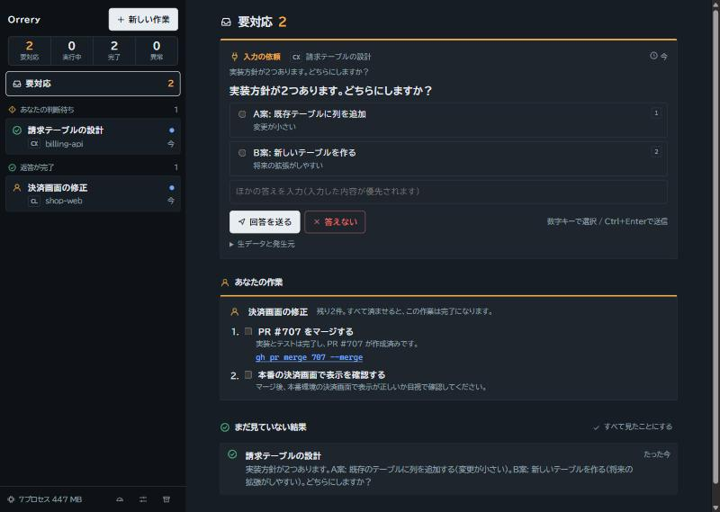

# Orrery

複数の AI コーディングエージェント（Claude Code と Codex）を同時に走らせるときの、**人間側の見張り役**になる Windows 用デスクトップアプリです。

エージェントが質問や承認を求めると、どの作業からのものでも 1 か所の「要対応」に並びます。人間はそこで答えるだけでよく、ターミナルを 1 つずつ見て回る必要がありません。



## できること

- **要対応の集約**：全作業の質問・承認・「あなたの作業」（PR のマージなど人間にしかできないこと）を 1 つの一覧にまとめ、作業を開かずにその場で答えられる
- **作業ごとのフォルダ**：git のプロジェクトでは、作業ごとに専用の worktree とブランチを作るので、同じプロジェクトで何件並べても干渉しない
- **完了の確認**：検証コマンド（例：`npm test`）を登録しておくと、エージェントの返答が終わるたびに実行し、成功・失敗で振り分ける
- **見回らなくて済む工夫**：実行中の作業が「いま何をしているか」を 1 行で表示、止まっている作業を琥珀色で表示、判断が必要になると Windows の通知とトレイアイコンで知らせる
- **同時実行数の上限と順番待ち**、利用枠（5 時間枠・週間枠）の表示、プロジェクトごとの環境変数（暗号化して保存）

詳しい使い方は [Runbook](docs/04-Runbook.md) を見てください。

## 動作環境

| 必要なもの | 確認方法 |
|---|---|
| Windows 11 | — |
| Node.js 24 以上 | `node --version` |
| Claude Code にログイン済み | `claude auth status` で `loggedIn: true` |
| Codex にログイン済み（使う場合） | Codex アプリ、VS Code 拡張、または `codex login` |

macOS・Linux には対応していません（プロセス管理に Windows の Job Object を使っています）。

## インストール

```powershell
git clone https://github.com/Takana-12/orrery.git
cd orrery
npm install
npm run install-app
```

`release\Orrery-win32-x64\Orrery.exe` が作られ、スタートメニューに「Orrery」が登録されます。以後はスタートメニューから起動します。ウィンドウを閉じてもトレイに残り、エージェントは動き続けます。終了はトレイアイコンの右クリックから行います。

開発中は、アプリを作らずに `npm run app` で起動できます。

## 注意事項

- **非公式のツールです。** Anthropic・OpenAI とは関係がありません。
- **Orrery は認証情報を読みません。** ログインは Claude Code・Codex の公式ツール側で行い、Orrery はそれらの公式バイナリを起動するだけです。パスワードやトークンを Orrery に入力・保存することはありません。
- **利用規約は各自で確認してください。** Claude のプラン（Pro/Max）のログインで Agent SDK を自作ツールから使うことについて、規約上の明確な許可・禁止の文は見つかっていません。調べた内容は [技術選定レポート §5](docs/01-技術選定レポート.md#5-既存サブスクリプションとの互換性) にまとめています。
- **自分の PC 専用です。** 内部のサーバーは `127.0.0.1` にだけつながり、起動ごとのトークンがないと操作できません。
- 会話の記録は `%LOCALAPPDATA%\AgentControlRoom\control-room.sqlite` に**平文**で保存されます。共有やコミットをしないでください。
- エージェントは承認した範囲でコマンドを実行し、ファイルを変更します。重要なリポジトリでは承認の設定に注意してください。

## 開発

```powershell
npm test           # 単体テスト（エージェントは使わない）
npm run typecheck  # 型チェック
npm run e2e        # 本物の Claude Code と Codex を使う受け入れテスト（10 分強、プランの利用枠を少し消費）
```

| ドキュメント | 内容 |
|---|---|
| [docs/04-Runbook.md](docs/04-Runbook.md) | セットアップ、使い方、データの場所、障害時の対処、既知の制限 |
| [docs/01-技術選定レポート.md](docs/01-技術選定レポート.md) | 方式の比較、検証結果、規約との関係 |
| [design.md](design.md) | UI のデザインガイド |

## サポートについて

個人で作っているプロジェクトです。バグ報告や要望は [Issues](../../issues) で歓迎しますが、返信や修正の時期は約束できません。セキュリティ上の問題は Issue に書かず、[SECURITY.md](SECURITY.md) の方法で知らせてください。

## ライセンス

[MIT](LICENSE)
