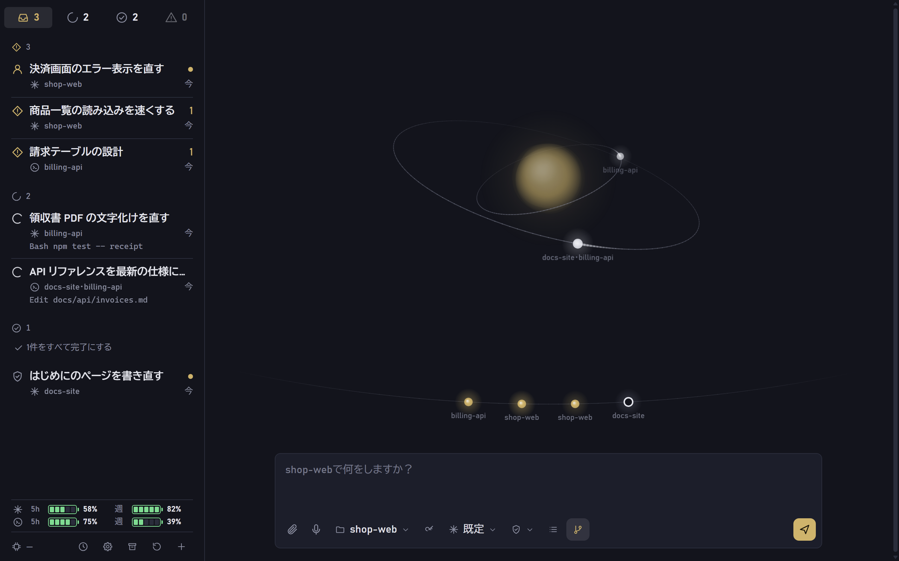
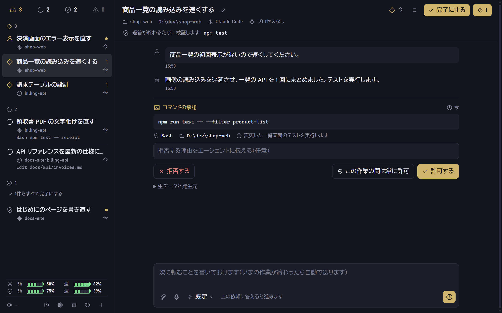

# Orrery

複数の AI コーディングエージェント（Claude Code と Codex）を同時に走らせるときの、**人間側の見張り役**になるデスクトップアプリです。**Windows** と **macOS** で動きます。

エージェントが質問や承認を求めると、どの作業からのものでも 1 か所の「要対応」に並びます。人間はそこで答えるだけでよく、ターミナルを 1 つずつ見て回る必要がありません。



## できること

- **要対応の集約**：全作業の質問・承認・「あなたの作業」（PR のマージなど人間にしかできないこと）を 1 つの一覧にまとめ、作業を開かずにその場で答えられる
- **作業ごとのフォルダ**：git のプロジェクトでは、作業ごとに専用の worktree とブランチを作るので、同じプロジェクトで何件並べても干渉しない
- **完了の確認**：検証コマンド（例：`npm test`）を登録しておくと、エージェントの返答が終わるたびに実行し、成功・失敗で振り分ける
- **見回らなくて済む工夫**：実行中の作業が「いま何をしているか」を 1 行で表示、止まっている作業を琥珀色で表示、判断が必要になると OS の通知とトレイ（macOS ではメニューバーと Dock）のアイコンで知らせる
- **音声で頼む**：Space を長押しして話すと、内容からどの作業を・どのワークスペースで・どの AI とモデルに頼むかを判断して始める（1 回の発話から複数の作業にも分かれる）。作業の画面で話せばその作業への返信になり、ほかの画面でも「さっきの〇〇のやつ」のように既存の作業を指せば、その作業への返信として送る。音声の認識は PC の中で行い、録音は外に送らない（初回に約 230 MB の認識モデルを取得。文字にした依頼文は、振り分け役の AI に渡る）
- **スケジュール実行**：「平日 09:00」「2時間ごと」「12/01 12:00 に1回」のように決めた時刻に、指示文どおりの作業を自分で始める。結果は Webhook にも送れ、スケジュールごとに環境変数を持てる
- **調査の返答はそのまま読める**：作業を「調査」と「作業」に自動で分け、調査の返答は手順や質問に分解せず、書かれたとおりに表示する
- **パスをクリックで開く**：AI の出力に出てきたファイル・フォルダのパスを押すと、既定のアプリ（フォルダはエクスプローラー / Finder）で開く
- **同時実行数の上限と順番待ち**、利用枠（5 時間枠・週間枠）の表示、プロジェクトごとの環境変数（暗号化して保存）



詳しい使い方は [Runbook](docs/04-Runbook.md) を見てください。

## 動作環境

| 必要なもの | 確認方法 |
|---|---|
| Windows 11、または macOS（Apple シリコン） | — |
| Git | `git --version`（macOS で入っていなければ `xcode-select --install`） |
| Node.js 24 以上 | `node --version` |
| Claude Code にログイン済み | `claude auth status` で `loggedIn: true` |
| Codex にログイン済み（使う場合） | Codex アプリ、VS Code 拡張、または `codex login` |

Linux には対応していません。Intel の Mac は、同じ手順でビルドできるはずですが確かめていません。

> **macOS 版について**：v0.6.0 で加わりました。Windows 版と同じ機能を持ち、変更のたびに GitHub Actions が macOS 上でテストと「ビルドしたアプリの起動確認」を行っています。一方で、メニューバーの表示・通知・マイクの許可など、実機でしか確かめられない部分の利用実績はまだ少ないので、おかしな点があれば [Issues](../../issues) で知らせてください。Windows 版との違いは「[macOS での違い](#macos-での違い)」にまとめています。

## インストール

手順は Windows と macOS で同じです。自分の PC でソースからアプリを作ります（署名済みのインストーラーは配っていません）。

```sh
git clone https://github.com/Takana-12/orrery.git
cd orrery
npm install
npm run install-app
```

### Windows

`release\Orrery-win32-x64\Orrery.exe` が作られ、スタートメニューに「Orrery」が登録されます。以後はスタートメニューから起動します。

ウィンドウを閉じてもトレイ（通知領域）に残り、エージェントは動き続けます。終了はトレイアイコンの右クリックから行います。

### macOS

上のコマンドは「ターミナル」で実行します。`release/Orrery-darwin-arm64/Orrery.app` が作られ、`~/Applications`（ホームの「アプリケーション」フォルダ）に「Orrery」が登録されます。以後は Finder のアプリケーション、Spotlight（⌘Space →「Orrery」）、Launchpad から起動します。Dock に置きたい場合は、起動中に Dock のアイコンを右クリック →「オプション」→「Dock に追加」を選びます。

- ウィンドウを閉じても（⌘W）メニューバーと Dock に残り、エージェントは動き続けます。ウィンドウは Dock のアイコンかメニューバーのアイコンから戻せます。
- 終了は、メニューバーのアイコン →「終了（エージェントも停止）」、または ⌘Q です。動いている作業があれば確認が出ます。
- 自分の Mac で作ったアプリなので、通常は「開発元を確認できません」の警告は出ません。出た場合は、Finder でアプリを右クリック →「開く」を選んでください。
- 音声入力をはじめて使うときに、macOS がマイクの許可をたずねます。
- プロジェクトの環境変数をはじめて保存するときに、暗号化の鍵をログインキーチェーンに作ります（項目名「Orrery」）。

開発中は、どちらの OS でも、アプリを作らずに `npm run app` で起動できます。

### macOS での違い

| | Windows | macOS |
|---|---|---|
| 常駐する場所 | トレイ（通知領域） | メニューバー＋Dock（判断待ちの件数を Dock のバッジで表示） |
| 送信のキー | Ctrl+Enter | ⌘+Enter（Ctrl+Enter も使えます） |
| データの場所 | `%LOCALAPPDATA%\AgentControlRoom` | `~/Library/Application Support/AgentControlRoom` |
| 環境変数の暗号化 | Windows の DPAPI | ログインキーチェーンに置いた鍵（AES-256-GCM） |
| Orrery が強制終了されたとき | 起動したプロセスは OS がすべて終了させる | 通常の終了ではすべて終了させる。`kill -9` や電源断のときは、エージェントが起動したもの（開発サーバーなど）が残ることがある |
| 更新のあと | そのまま | マイクの許可をもう一度たずねられることがある（署名していないため） |

## アップデート

Orrery は、起動したときと、その後 1 時間ごとに、GitHub に新しい版があるかを確かめます（設定 →「アプリの更新」の「今すぐ確認」でもすぐ確かめられます）。新しい版があると、左バーの更新ボタンに点が付きます。

更新ボタンを押すと、次をまとめて行い、終わると自動で開き直します。作っている間も、いまのアプリはそのまま使えます。Windows でも macOS でも同じです。

1. `git pull`（新しい版を取り込む）
2. `npm install`（依存が変わったときだけ）
3. アプリを作り直す

- 自分でファイルを変えていて取り込めないときは、その理由が表示されます。`git stash` で退けてから、もう一度押してください。
- 自分のコミットを積んでいる場合は、勝手にマージしないよう自動では取り込みません。`git pull` を手で行ってから更新ボタンを押してください。
- どこかで失敗しても、いまの版のまま動き続けます。
- 新しい版が出たことをメールなどで知りたい場合は、GitHub のこのリポジトリの **Watch → Custom → Releases** を選んでください。

## 注意事項

- **非公式のツールです。** Anthropic・OpenAI とは関係がありません。
- **Orrery は認証情報を読みません。** ログインは Claude Code・Codex の公式ツール側で行い、Orrery はそれらの公式バイナリを起動するだけです。パスワードやトークンを Orrery に入力・保存することはありません。
- **利用規約は各自で確認してください。** Claude のプラン（Pro/Max）のログインで Agent SDK を自作ツールから使うことについて、規約上の明確な許可・禁止の文は見つかっていません。調べた内容は [技術選定レポート §5](docs/01-技術選定レポート.md#5-既存サブスクリプションとの互換性) にまとめています。
- **自分の PC 専用です。** 内部のサーバーは `127.0.0.1` にだけつながり、起動ごとのトークンがないと操作できません。
- 会話の記録は、データの場所（Windows：`%LOCALAPPDATA%\AgentControlRoom`、macOS：`~/Library/Application Support/AgentControlRoom`）の `control-room.sqlite` に**平文**で保存されます。共有やコミットをしないでください。
- エージェントは承認した範囲でコマンドを実行し、ファイルを変更します。重要なリポジトリでは承認の設定に注意してください。

## 開発

```sh
npm test           # 単体テスト（エージェントは使わない）
npm run typecheck  # 型チェック
npm run smoke      # アプリをビルドし、起動・応答・停止までを確かめる（一時フォルダに作るので、入れてあるアプリには触れない）
npm run e2e        # 本物の Claude Code と Codex を使う受け入れテスト（10 分強、プランの利用枠を少し消費）
npm run screenshots  # README の画像を、架空のデータで今の画面から撮り直す（docs/images/）
```

Windows と macOS の両方で動かし続けるために、**OS に依存するコードは `packages/host/` と `apps/desktop/platform/` の 2 か所だけ**に置いています。それ以外の場所に書くとテストが落ち、push すると GitHub Actions が両方の OS でテストとアプリの起動確認を行います。片方の OS しか持っていなくても、もう片方を壊さずに変更できます。しくみは [docs/08-対応OSと移植層.md](docs/08-対応OSと移植層.md) にあります。

| ドキュメント | 内容 |
|---|---|
| [docs/04-Runbook.md](docs/04-Runbook.md) | セットアップ、使い方、データの場所、障害時の対処、既知の制限 |
| [docs/08-対応OSと移植層.md](docs/08-対応OSと移植層.md) | Windows と macOS の両方で動かすための構造、機能を足すときの手順、確かめ方 |
| [docs/09-スケジュール.md](docs/09-スケジュール.md) | スケジュール実行のしくみと、決めたことの理由 |
| [docs/01-技術選定レポート.md](docs/01-技術選定レポート.md) | 方式の比較、検証結果、規約との関係 |
| [design.md](design.md) | UI のデザインガイド |
| [docs/06-公開と運用.md](docs/06-公開と運用.md) | 管理者向け：公開リポジトリの更新、プルリクエストの取り込み方 |

## サポートについて

個人で作っているプロジェクトです。バグ報告や要望は [Issues](../../issues) で歓迎しますが、返信や修正の時期は約束できません。プルリクエストの出し方は [CONTRIBUTING.md](CONTRIBUTING.md) を見てください。セキュリティ上の問題は Issue に書かず、[SECURITY.md](SECURITY.md) の方法で知らせてください。

## ライセンス

[MIT](LICENSE)
